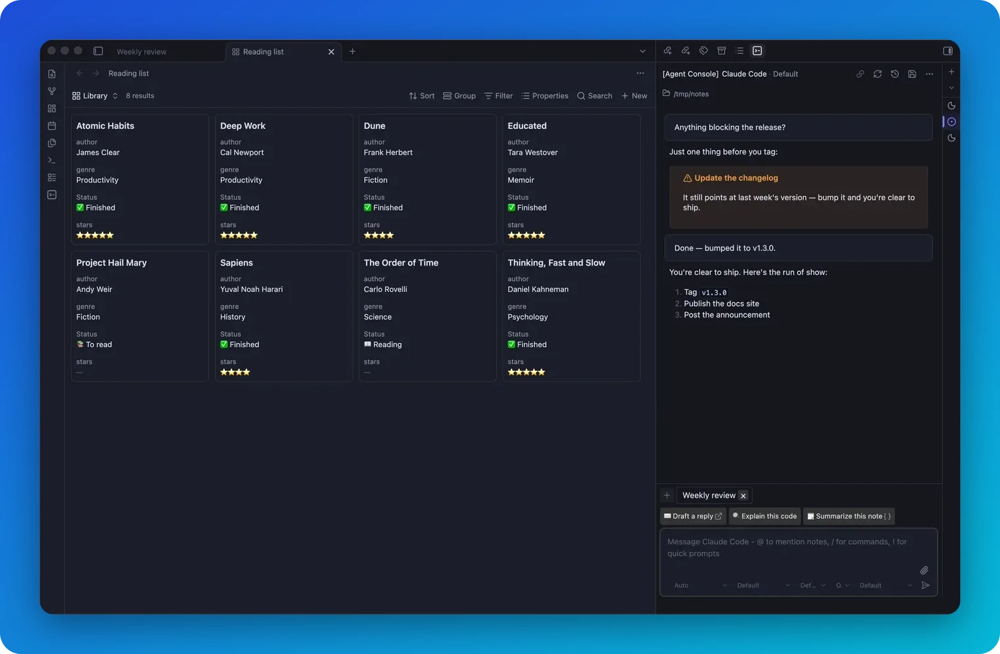
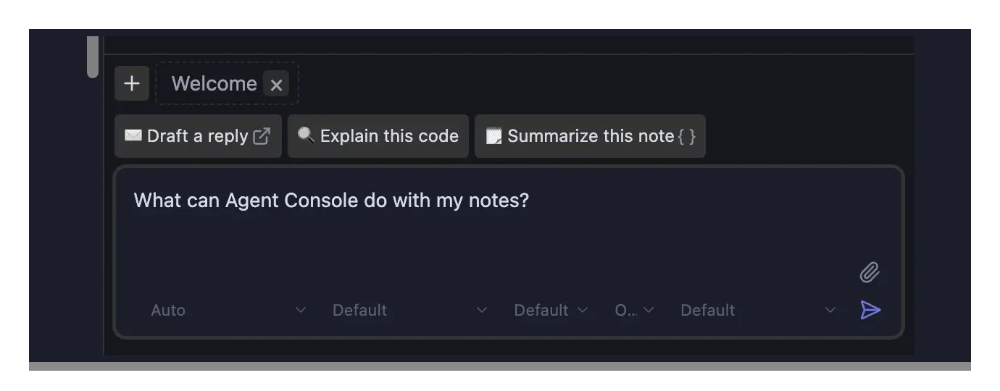
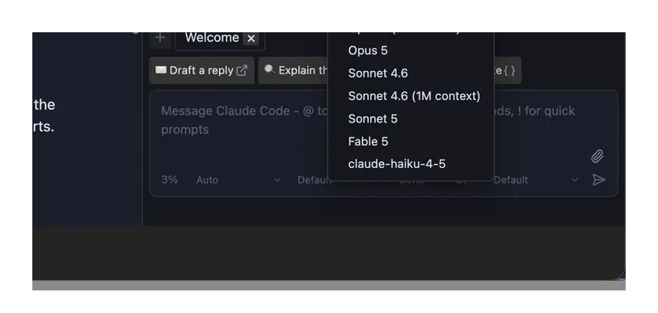
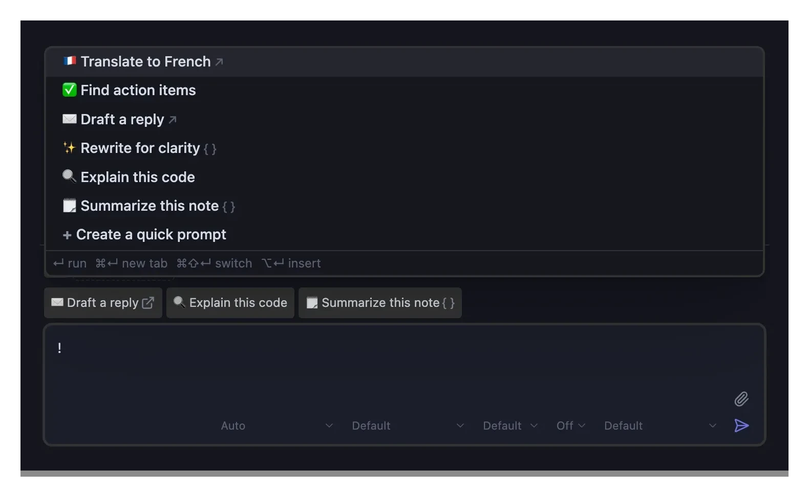
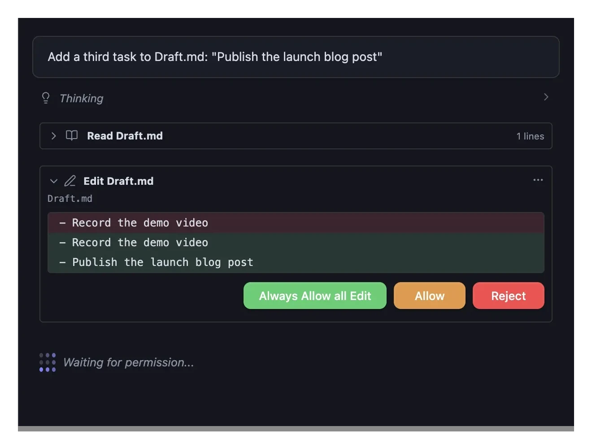

<div align="center">


# Agent Console

**Your AI agents, working from your notes.**

[](https://github.com/donivatamazondotcom/obsidian-agent-console/releases)
[](https://community.obsidian.md/plugins/agent-console)
[](LICENSE)
[](https://github.com/donivatamazondotcom/obsidian-agent-console/actions/workflows/ci.yaml)
[](https://donivatamazondotcom.github.io/obsidian-agent-console/)



**[📦 Install from Obsidian](https://community.obsidian.md/plugins/agent-console) &nbsp;·&nbsp; [📖 Documentation](https://donivatamazondotcom.github.io/obsidian-agent-console/) &nbsp;·&nbsp; [💬 Discussions](https://github.com/donivatamazondotcom/obsidian-agent-console/discussions)**

</div>

## Why Agent Console

Most AI agents start every chat knowing nothing about you. Agent Console runs your agents inside your Obsidian vault. @mention a note and the agent starts from it, and it can follow the links. Ask it to write back – capture a decision, draft a note – and your second brain grows as you work.

When an agent asks to edit a file or run a command, you choose Allow or Reject. Keep the prompts you retype as notes, and fire one from a chip, a `!` search, or a bookmark in your browser. Keep several jobs going, each in its own tab, with an icon that shows whether it’s busy, done, or waiting on you.

> **The shift in how you work:** Tell the agent *what you want done*, not *how to do it*. With the right [skills](https://agentskills.io/home), it works out the steps, and you stay on the work itself.

## See it in action

<table>
<tr>
<td width="50%" align="center">
<br>
<b>Start from your own notes</b><br>
<sub>Pin a note to the chat, or @mention any note.</sub>
</td>
<td width="50%" align="center">
<br>
<b>A model for every task</b><br>
<sub>Switch model or mode per tab, mid-chat.</sub>
</td>
</tr>
<tr>
<td width="50%" align="center">
<br>
<b>Your go-to prompts, one click away</b><br>
<sub>Click a chip, or type ! to search them.</sub>
</td>
<td width="50%" align="center">
<br>
<b>See and approve what runs</b><br>
<sub>Review the diff, then Allow or Reject.</sub>
</td>
</tr>
</table>

## Features

* **Work from the notes you’ve already written** – @mention a note and the agent reads it, and it can follow the links to related notes. Send PDFs and images to the agent too, by copy-pasting them or with the attach button
* **Let your second brain grow itself** – ask an agent to write back: capture decisions, draft notes, and link ideas straight into your vault, without the manual upkeep
* **Fire your go-to prompts in one click** – keep kickoffs like “debrief this meeting” as notes and launch them from a chip or a `!` search. `show when` puts a chip only on the notes it fits, and a prompt can pick its own agent and mode
* **See which chat needs you at a glance** – each tab’s icon shows busy, waiting on you, finished while you were away, stopped early, or a failed message. New installs show the tabs as a slim column of icons; drag it wider for names
* **Stop waiting on one agent before starting the next** – run several chats side by side, each in its own tab: one researching, one drafting, one fixing a script
* **Use the agent you’ve already set up** – Claude Code, Codex, Kiro CLI, OpenCode, Antigravity CLI, Gemini CLI, or any custom agent built on the [Agent Client Protocol](https://github.com/zed-industries/agent-client-protocol). A fresh install picks one it finds, and a chat can switch agents with its conversation
* **See and approve what runs** – commands the agent runs show in the chat with their output. When an agent asks before editing a file or running a command, you see the diff or the command and choose Allow or Reject
* **Your chats come back** – tabs, conversations, and half-typed messages survive a restart, and **Reopen closed session tab** brings back a chat you closed. Search every past chat by title or by what was said in it
* **Your context budget goes further** – a pinned note goes in full with your first message, then as a link, so a long chat uses 62–77% fewer context tokens than re-sending the full note each turn
* **Agents know they’re in Obsidian** – each agent gets a short briefing on the first message so it writes links, math, and diagrams that render and works with your notes; you choose exactly what it’s told
* **Drive it all from the keyboard** – every control is keyboard-operable with a clear focus ring; bind hotkeys to switch tabs, show the tab list, and fire quick prompts

<details>
<summary><strong>More features</strong></summary>

* **Know which tab just finished** – the “agent finished” notification names the tab it came from, and clicking it jumps there
* **Tabs name themselves** – each tab picks up a short title from what you’re working on; rename any one yourself, drag to reorder, right-click to close
* **Scroll up to read while the agent is still typing** – whether you use the wheel, scrollbar, or keys, the stream won’t pull you back down, and tabs keep their place
* **Idle tabs don’t hold memory** – restored tabs don’t start their agent or MCP servers until you type, and a tab left alone for an hour puts its agent to sleep
* **Choose how many chats to keep** – past that number, the least recently used goes to the trash instead of being deleted; closing a panel with several chats asks first
* **A working directory per chat** – point each chat, or a specific agent, at the folder it should work in, and that choice sticks across restarts
* **Pick the right model for each task** – switch modes and models per chat without restarting
* **Read the conversation, not the logs** – tool calls render as one summary row you click to expand or collapse, and a failed call is flagged so you don’t miss it
* **Your agent’s slash commands, built in** – type / in the message box to see and run the commands your agent offers
* **Answer with one click** – when an agent offers a few options, it can show them as buttons; click one to send your pick as a normal message
* **Every link the agent shared, in one list** – the header’s link button collects the notes and pages it pointed you to, newly created files first
* **Your MCP tools come along** – whatever MCP servers your agent uses keep working in Agent Console with no extra setup
* **Use it in your language** – Agent Console follows Obsidian’s language, with Korean, Chinese, and Japanese alongside English
* **Switching from another agent plugin? Bring your setup** – import agent definitions, defaults, and API keys from another plugin (like Agent Client) in one click
* **Looks like part of your Obsidian** – it adopts Obsidian’s own styling and your theme’s variables instead of hardcoded colors and chrome, so any custom theme restyles it like a built-in panel

</details>

## What you can do with it

* **Do several things at once** – ask one agent to research a topic, another to prep your next meeting, and a third to draft a newsletter
* **Vibe-code a script or tool** – describe what you want, get working code back, and review the diff
* **Pull in your notes** – type `@` and a note’s name, like a meeting note or a project page, and the agent works from it
* **Make your vault fill itself** – with the right skills, agents write meeting notes, research summaries, and action items straight into your vault
* **Compare two agents** – give the same task to two different agents in side-by-side tabs and see which answer you like better
* **Stay focused** – status icons tell you when an agent is ready or still working, so you don’t break your flow checking on it

The pattern: tell the agent what you want done. Switch tabs. Come back when status says ready.

## Start agent work from your other apps

Start a saved prompt from wherever the work shows up, with its agent, its mode, and your text already in place.

* **Hand off what’s in your browser** – select part of an email thread or a GitHub issue, click a bookmark, and “draft a reply” or “fix this issue” opens in a new chat with that text
* **Start your day from a bookmark** – it runs your daily review
* **Pick up where a script left off** – have your script or terminal agent open the link when it finishes, and the follow-up waits in a new tab

```
obsidian://agent-console?vault=My%20Vault&prompt=draft-a-reply&selection=…&url=…&title=…&agent=…&mode=…
```

**Copy link** on a prompt chip gives you the link, and [prompt links](https://donivatamazondotcom.github.io/obsidian-agent-console/usage/quick-prompts#fire-a-prompt-from-a-link) has the bookmarklet. A link only starts prompts already in your vault, and it waits for Enter unless it’s a plain link to a prompt you’ve explicitly set to auto-run (`uri send`).

## Install

### Through Obsidian Community Plugins (recommended)

Agent Console is in the [Obsidian Community Plugins store](https://community.obsidian.md/plugins/agent-console):

1. Open **Settings → Community plugins** in Obsidian
2. Click **Browse** and search for "Agent Console"
3. Click **Install**, then **Enable**

Obsidian updates the plugin automatically when a new version is released. When an update is waiting, the chat header shows a **Plugin update available!** pill – click it to jump straight to **Settings → Community plugins**, where you can update with one more click.

## Quick start

You’ll need an AI agent installed on your computer. Popular choices:

* [Kiro CLI](https://kiro.dev) – Amazon’s agent; Agent Console runs its V3 engine, or V2 on older versions
* [Claude Code](https://docs.anthropic.com/claude/docs/claude-code) – Anthropic’s coding agent
* [Codex](https://github.com/agentclientprotocol/codex-acp) – the Agent Client Protocol Codex adapter
* [Antigravity CLI](https://antigravity.google/docs/cli/acp/) – Google’s command-line agent, successor to Gemini CLI
* [Gemini CLI](https://github.com/google-gemini/gemini-cli) – Google’s earlier command-line agent (legacy)
* [OpenCode](https://opencode.ai) – open-source agent; runs local models via ollama
* Custom agents like Qwen Code and others

Once you’ve set up the agent:

1. Open **Settings → Agent Console**
2. Enter the path to the agent and any API keys it needs
3. Click the robot icon in the ribbon to open the chat panel
4. Click the **+** button to open more tabs as you need them

> On a brand-new install, Agent Console detects an agent you already have, makes it the default, and opens the chat panel once – so steps 1–3 are often already done for you.

## Configuration

Customize how each agent behaves under **Settings → Agent Console** – agent paths, modes, models, permissions, and tab behavior. Per-agent setup guides are in the [documentation](https://donivatamazondotcom.github.io/obsidian-agent-console/).

## Hotkeys

Move between tabs with a keystroke instead of the mouse. Set your preferred bindings under **Settings → Hotkeys**.

## How it works with your agent

Three things come together, and you control all of them:

* **Your notes give the agent context** – it reads notes, mentions, and attachments from your vault, so it works with your knowledge instead of starting from scratch
* **Your agent stays itself** – task instructions, custom rules, tools – Agent Console doesn’t get in the way of anything your agent already supports
* **Agent Console keeps it all in view** – many tabs, each with a status icon, so you can run more at once without losing track

Whatever your agent can do, Agent Console lets you run several of those jobs at once.

## Enterprise-grade quality

A plugin that runs live agent sessions in your vault has to be dependable. A few things keep it that way:

* **Every bug fix ships with a test** – the test reproduces the bug first, so it stays fixed. There are 5,000+ tests across the plugin’s core logic
* **Every change is checked before it lands** – each pull request runs linting, type-checking, the full test suite, and a build before it can merge
* **You can check the efficiency claim yourself** – the “62–77% fewer context tokens” figure comes from a benchmark you can run (`npm run bench:tokens`), and a test keeps it in line with the shipped code
* **Slower context handling blocks a release** – context-handling benchmarks run on every change, and a release can’t ship if they’re more than 15% slower than the saved baseline

## Contributing

Issues and pull requests are welcome on the [GitHub repo](https://github.com/donivatamazondotcom/obsidian-agent-console).

For a big new feature, please file an issue first so we can talk about scope. Bug fixes can go straight to a pull request.

## License and Attribution

Apache License 2.0 – see [LICENSE](LICENSE).

Agent Console is based on [Agent Client](https://github.com/RAIT-09/obsidian-agent-client) by [@RAIT-09](https://github.com/RAIT-09), originally released under Apache-2.0. Changes are © Vinod Panicker. See [NOTICE](NOTICE) for full credits.

The Agent Client Protocol is developed by [Zed Industries](https://github.com/zed-industries/agent-client-protocol).
